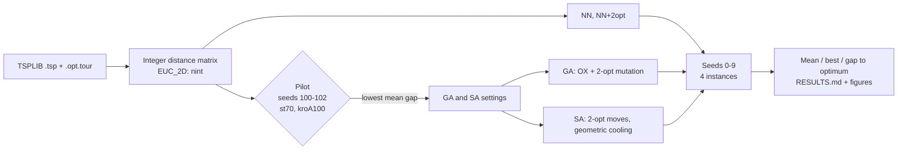
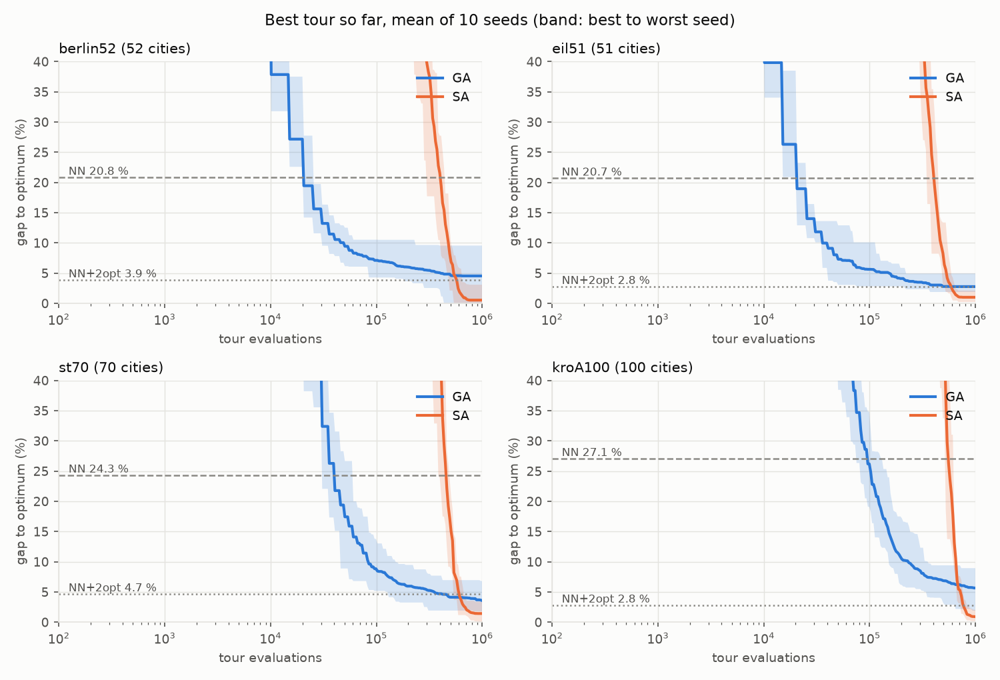
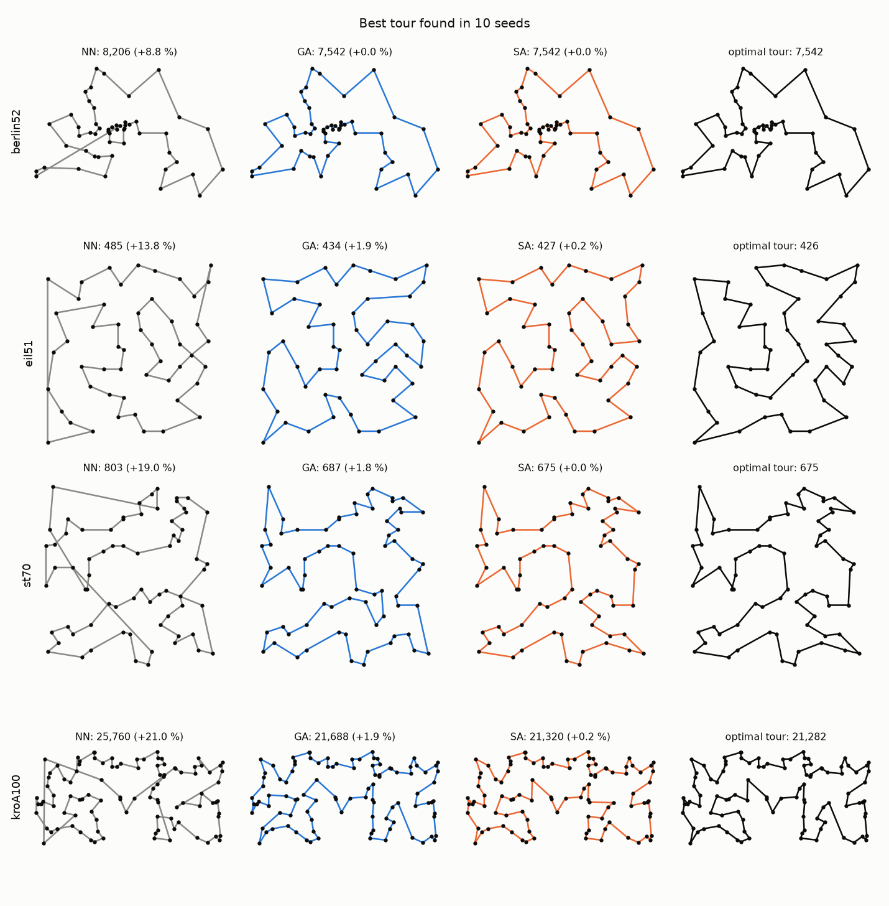

# tsp-metaheuristics

A genetic algorithm (order crossover, 2-opt mutation) and simulated annealing for the symmetric
travelling salesman problem, written from scratch in Python and NumPy. They are compared with a
nearest-neighbour baseline on four TSPLIB instances, over 10 seeds each, by mean and best tour
length and by the gap to the proven optimum.

[](https://www.python.org/)
[](LICENSE)
[](https://github.com/yousefibehnam/tsp-metaheuristics/actions/workflows/ci.yml)

## Timeline

- **2026:** implemented as a classic Algorithms / Optimization project for my portfolio

## Features

- **TSPLIB reader** for `.tsp` and `.tour` files with TSPLIB's exact integer distances (`EUC_2D`,
  `CEIL_2D`, `ATT`). The tests check that the published optimal tours have exactly the published
  optimal lengths.
- **Baselines:**
  - nearest neighbour (NN) from a random start city;
  - NN followed by best-improvement 2-opt local search (NN+2opt), as a stronger reference.
- **Genetic algorithm (GA):**
  - order crossover (OX) and 2-opt mutation, which reverses a random segment and so replaces two
    edges;
  - tournament selection and elitism;
  - random initial tours.
- **Simulated annealing (SA):**
  - 2-opt moves whose length change is computed in O(1);
  - geometric cooling, with the starting temperature calibrated from random moves.
- **Fair budget.** GA and SA both get 1,000,000 tour evaluations per run (GA: one per child; SA: one
  per proposed move). Wall-clock time is reported as well.
- **Separate parameter pilot.** GA and SA settings were chosen by a small grid search on seeds that
  the reported results never use.
- **Outputs:**
  - mean, standard deviation, best and worst tour length;
  - gap to the optimum and number of optimal runs;
  - convergence curves and tour plots.
- **CLI:** `tspmh solve`, `tspmh pilot` and `tspmh experiment`.

## Method



**Genetic algorithm.** Each generation:
- keeps the 2 best tours;
- breeds the rest of the population from parents picked by 3-way tournaments;
- recombines parents with OX at rate 0.9: OX copies a random slice of one parent and fills the
  remaining positions with the other cities in the order they appear in the second parent;
- mutates each child with the chosen probability by reversing a random segment.

**Simulated annealing.**
- Each step proposes reversing a random segment `tour[i..j]`. The length change involves only the
  two removed and two added edges, so it costs O(1).
- Improvements are always accepted, and a longer tour with probability `exp(-delta / T)`.
- `T` starts where an average uphill move is accepted with the chosen probability, then falls
  geometrically to the chosen fraction of that start over the budget.

**Parameter pilot** ([results/pilot.md](results/pilot.md)):
- **Grid:** GA population {50, 100, 200} × mutation rate {0.1, 0.3, 0.6}; SA initial acceptance
  {0.3, 0.5, 0.8} × final/initial temperature {10⁻², 10⁻³, 10⁻⁴}.
- **Runs:** st70 and kroA100 with **seeds 100, 101 and 102**, disjoint from the seeds 0–9 in the
  results below.
- **Chosen** (lowest mean gap):
  - **GA:** population 50, mutation rate 0.6. Crossover rate 0.9, tournament size 3 and 2 elites
    were fixed in advance.
  - **SA:** initial acceptance 0.5, final/initial temperature 0.01.
- A test checks that the settings in the code match what the committed `pilot.json` selects.

## Dataset

Four symmetric instances from **TSPLIB** (Reinelt, 1991), downloaded from the TSPLIB 95 site at
Heidelberg University by `scripts/download_data.sh`, which checks SHA-256 checksums. The data is
not stored in this repository.

| Instance | Cities | Optimum | Origin (TSPLIB comment) |
|---|---|---|---|
| berlin52 | 52 | 7,542 | 52 locations in Berlin (Groetschel) |
| eil51 | 51 | 426 | 51-city problem (Christofides/Eilon) |
| st70 | 70 | 675 | 70-city problem (Smith/Thompson) |
| kroA100 | 100 | 21,282 | 100-city problem A (Krolak/Felts/Nelson) |

Dataset chosen to match the period of the original project (2016–2018).

Please cite TSPLIB when using these instances:

- G. Reinelt. *TSPLIB — A Traveling Salesman Problem Library.* ORSA Journal on Computing 3(4),
  376–384, 1991. <https://doi.org/10.1287/ijoc.3.4.376>
- Source: <https://comopt.ifi.uni-heidelberg.de/software/TSPLIB95/>

## Installation and usage

```bash
make install && make experiment   # venv, download, 4 instances x 10 seeds -> results/ (~12 min)
```

Solve a single instance, by TSPLIB name or from any `EUC_2D` `.tsp` file:

```bash
.venv/bin/tspmh solve berlin52                      # SA with the chosen settings
# berlin52: SA length 7,542 (optimum 7,542, gap 0.00 %) in 0.41 s
.venv/bin/tspmh solve kroA100 -a 2opt
# kroA100: 2-opt length 21,919 (optimum 21,282, gap 2.99 %) in 0.01 s
.venv/bin/tspmh solve eil51 -a ga --evaluations 200000 --tour   # --tour prints the city order
.venv/bin/tspmh pilot                               # rerun the parameter pilot (~30 min)
```

Long runs log to `data/logs/` and print progress unbuffered. `make test` runs the tests, including
the check against TSPLIB's optimal tours once the data is downloaded. `make lint` runs ruff and
shellcheck.

## Results

From [results/RESULTS.md](results/RESULTS.md). Seeds 0–9, 10 runs per algorithm and instance. GA and
SA had 1,000,000 tour evaluations per run. Gaps are relative to the proven optimum.

| Instance | NN | NN+2opt | GA | SA |
|---|---|---|---|---|
| berlin52 (52) | 20.83 % | 3.87 % | 4.54 % | **0.54 %** |
| eil51 (51) | 20.70 % | 2.77 % | 2.77 % | **1.01 %** |
| st70 (70) | 24.33 % | 4.67 % | 3.57 % | **1.44 %** |
| kroA100 (100) | 27.07 % | 2.82 % | 5.66 % | **0.90 %** |
| **mean gap** | 23.23 % | 3.53 % | 4.14 % | **0.97 %** |
| best gap (best seed) | 8.8–21.0 % | 0.5–1.5 % | 0.0–1.9 % | **0.0–0.2 %** |
| optimal runs (of 40) | 0 | 0 | 2 | **9** |
| time per run | < 1 ms | 2–10 ms | ~17 s | ~0.4 s |



What the numbers say:

- **Simulated annealing is clearly the best.**
  - It is within 1 % of the optimum on average (0.54–1.44 % per instance), and its worst run of all
    40 is 3.4 % above the optimum (st70, 698).
  - It finds the optimal tour in 8 of 10 berlin52 runs and in 1 of 10 st70 runs.
  - It needs about 0.4 s per run.
- **The plain GA is no better than a 10 ms local search.**
  - Averaged over the four instances, its gap is 4.14 %, against 3.53 % for NN+2opt.
  - It loses to NN+2opt on berlin52 and kroA100, ties on eil51 and wins only on st70.
  - It is also about 40 times slower than SA per run: copying and evaluating whole tours costs O(n)
    per child, whereas an SA move costs O(1).
  - A GA without a local-search step (a memetic algorithm) is known to be weak on the TSP, and these
    runs confirm it.
- **The GA is sensitive to its settings.** In the pilot, its mean gap ranged from 3.3 % to 21.6 %
  across the nine settings. SA's ranged from 0.7 % to 2.2 %.
- **SA only makes progress once it cools.** Early on it accepts many uphill moves: after 300,000
  evaluations its best tour is still 40–160 % above the optimum, so nearly all the improvement comes
  in the last two-thirds of the budget. So its result depends on fitting the cooling schedule to the budget. The GA
  improves steadily from the start, but then levels off.
- **Nearest neighbour** alone is 21–27 % above the optimum. Adding 2-opt removes most of that gap
  in a few milliseconds.



## Project structure

```
src/tspmh/
  tsplib.py      .tsp / .tour reader, TSPLIB integer distances, published optima
  heuristics.py  nearest neighbour, best-improvement 2-opt, O(1) 2-opt delta
  ga.py          genetic algorithm: OX, 2-opt mutation, tournament selection, elitism
  sa.py          simulated annealing with 2-opt moves and geometric cooling
  experiment.py  parameter pilot and the 10-seed comparison
  report.py      results/RESULTS.md and results/pilot.md
  plots.py       convergence curves and tour plots
  cli.py         tspmh solve | pilot | experiment
scripts/download_data.sh   TSPLIB download with SHA-256 checks
results/                   RESULTS.md, pilot.md, JSON results, figures
tests/                     pytest suite (brute-forced small instances, TSPLIB optimal tours)
```

## Limitations

- **Small instances.** These have 51–100 cities, small enough that SA often reaches the optimum.
  The ranking may change on instances with thousands of cities, where neighbour lists and Or-opt or
  Lin-Kernighan moves become necessary.
- **One budget.** All runs use 1,000,000 evaluations. A GA evaluation costs more than an SA move, so
  an equal-time comparison would favour SA even more.
- **Small pilot.** It used 3 seeds on 2 instances, which is noisy. For example, it can't tell
  whether the GA's 21.6 % for population 200 / mutation 0.6 (11.5 % on st70, 31.6 % on kroA100) is
  a real effect or seed noise. The chosen settings are reasonable rather than
  optimal, and the same settings serve all four instances.
- **Pure Python.** The algorithms are written for clarity, not speed; compiled code would be one to
  two orders of magnitude faster.
- **Plain GA, as specified.** It has no local search and no seeding with NN tours. Adding 2-opt to
  each child (a memetic GA) would likely close most of the gap to SA.

## License

MIT, see [LICENSE](LICENSE). The TSPLIB instances are not included; cite Reinelt (1991) when using
them.
