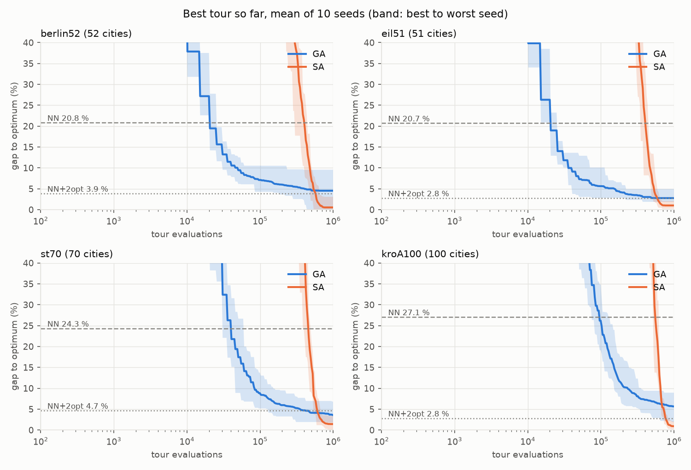
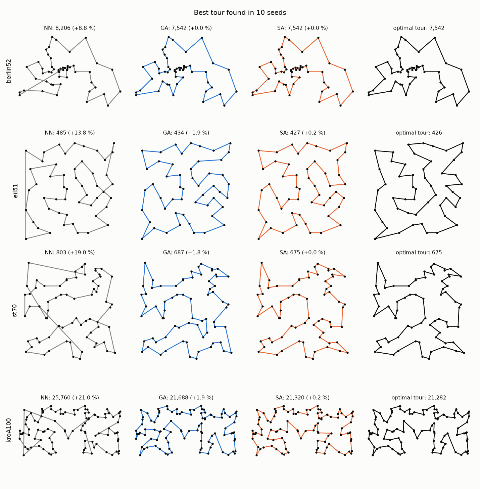

# Results

Generated by `tspmh experiment` (`make experiment`). Every algorithm ran with seeds 0–9 (10 runs per instance). GA and SA each had a budget of **1,000,000 tour evaluations** per run (GA: one per child; SA: one per proposed move).
Gaps are relative to the proven optimum published in TSPLIB.

| Algorithm | What it is |
|---|---|
| NN | nearest neighbour from a random start city |
| NN+2opt | the NN tour improved by best-improvement 2-opt until no move helps |
| GA | genetic algorithm, OX crossover + 2-opt mutation, random initial tours |
| SA | simulated annealing with 2-opt moves from a random tour |

Parameters: GA population = 50, mutation_rate = 0.6, crossover rate 0.9, tournament of 3, 2 elites; SA accept = 0.5, final_ratio = 0.01 (initial acceptance of an average uphill move, final / initial temperature), geometric cooling. Chosen by a pilot on other seeds ([pilot.md](pilot.md)).

## Summary: mean gap to the optimum over all runs

| Instance | n | Optimum | NN | NN+2opt | GA | SA |
|---|---|---|---|---|---|---|
| berlin52 | 52 | 7,542 | 20.83 % | 3.87 % | 4.54 % | 0.54 % |
| eil51 | 51 | 426 | 20.70 % | 2.77 % | 2.77 % | 1.01 % |
| st70 | 70 | 675 | 24.33 % | 4.67 % | 3.57 % | 1.44 % |
| kroA100 | 100 | 21,282 | 27.07 % | 2.82 % | 5.66 % | 0.90 % |
| **mean** | | | **23.23 %** | **3.53 %** | **4.14 %** | **0.97 %** |

## berlin52 (52 cities, optimum 7,542)

*52 locations in Berlin (Groetschel)*

| Algorithm | Mean ± sd | Best | Worst | Mean gap | Best gap | Optimal runs | Time per run |
|---|---|---|---|---|---|---|---|
| NN | 9,113.2 ± 593.8 | 8,206 | 10,093 | 20.83 % | 8.80 % | 0/10 | 0 ms |
| NN+2opt | 7,833.6 ± 135.2 | 7,657 | 8,075 | 3.87 % | 1.52 % | 0/10 | 2 ms |
| GA | 7,884.3 ± 214.5 | 7,542 | 8,263 | 4.54 % | 0.00 % | 2/10 | 16.6 s |
| SA | 7,582.6 ± 86.8 | 7,542 | 7,775 | 0.54 % | 0.00 % | 8/10 | 405 ms |

## eil51 (51 cities, optimum 426)

*51-city problem (Christofides/Eilon)*

| Algorithm | Mean ± sd | Best | Worst | Mean gap | Best gap | Optimal runs | Time per run |
|---|---|---|---|---|---|---|---|
| NN | 514.2 ± 21.3 | 485 | 549 | 20.70 % | 13.85 % | 0/10 | 0 ms |
| NN+2opt | 437.8 ± 5.0 | 432 | 446 | 2.77 % | 1.41 % | 0/10 | 2 ms |
| GA | 437.8 ± 3.9 | 434 | 447 | 2.77 % | 1.88 % | 0/10 | 16.7 s |
| SA | 430.3 ± 2.8 | 427 | 435 | 1.01 % | 0.23 % | 0/10 | 389 ms |

## st70 (70 cities, optimum 675)

*70-city problem (Smith/Thompson)*

| Algorithm | Mean ± sd | Best | Worst | Mean gap | Best gap | Optimal runs | Time per run |
|---|---|---|---|---|---|---|---|
| NN | 839.2 ± 27.1 | 803 | 881 | 24.33 % | 18.96 % | 0/10 | 0 ms |
| NN+2opt | 706.5 ± 17.8 | 685 | 740 | 4.67 % | 1.48 % | 0/10 | 4 ms |
| GA | 699.1 ± 11.3 | 687 | 721 | 3.57 % | 1.78 % | 0/10 | 16.9 s |
| SA | 684.7 ± 6.3 | 675 | 698 | 1.44 % | 0.00 % | 1/10 | 392 ms |

## kroA100 (100 cities, optimum 21,282)

*100-city problem A (Krolak/Felts/Nelson)*

| Algorithm | Mean ± sd | Best | Worst | Mean gap | Best gap | Optimal runs | Time per run |
|---|---|---|---|---|---|---|---|
| NN | 27,042.0 ± 945.4 | 25,760 | 28,566 | 27.07 % | 21.04 % | 0/10 | 0 ms |
| NN+2opt | 21,881.4 ± 363.0 | 21,393 | 22,626 | 2.82 % | 0.52 % | 0/10 | 10 ms |
| GA | 22,487.6 ± 482.1 | 21,688 | 23,186 | 5.66 % | 1.91 % | 0/10 | 17.3 s |
| SA | 21,474.4 ± 134.4 | 21,320 | 21,710 | 0.90 % | 0.18 % | 0/10 | 421 ms |
